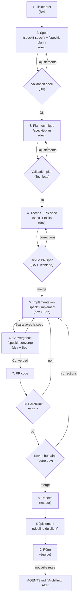
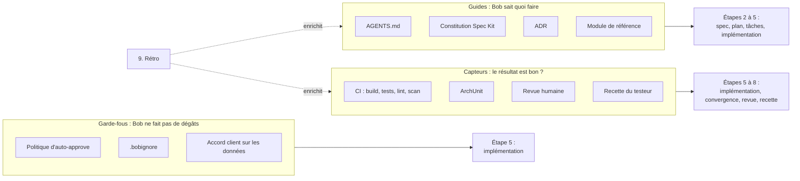

# Workflow de développement d'une feature : Spec Kit + IBM Bob

Cas de base : une feature de taille moyenne, un dev, quelques jours de travail.

## 1. Le process

## 2. Ce qui alimente le workflow

Trois familles, chacune avec un rôle différent. La base projet est posée une fois, puis enrichie à chaque rétro.

## 3. Ce qui intervient à chaque étape

1. **Ticket prêt** : Definition of Ready (besoin clair, critères d'acceptation présents).
2. **Spec** : constitution Spec Kit, AGENTS.md, ADR (contraintes déjà décidées).
3. **Plan technique** : ADR et constitution (validation du techlead contre ces références), module de référence comme modèle.
4. **Tâches + PR spec** : règles de PR (une PR spec, une PR code), revue BA + techlead.
5. **Implémentation** : AGENTS.md (stack, commandes, interdits), module de référence, politique d'auto-approve, `.bobignore`, CI et ArchUnit lancés en local et en continu.
6. **Convergence** : critères d'acceptation de la spec comme référence.
7. **PR code** : CI (build, tests, lint, scan des dépendances), ArchUnit, revue humaine, Definition of Done.
8. **Recette** : critères d'acceptation de la spec, cas de test du testeur.
9. **Rétro** : toute dérive de Bob devient une ligne dans AGENTS.md, une règle ArchUnit ou une ADR.

## 4. Qui valide quoi

- **BA** : la spec (étape 2) et le fonctionnel de la PR spec (étape 4).
- **Techlead** : le plan (étape 3) et le technique de la PR spec (étape 4). En filet à l'étape 7 seulement si la PR touche à l'architecture.
- **Autre dev** : la PR code (étape 7).
- **Testeur** : la recette (étape 8).
